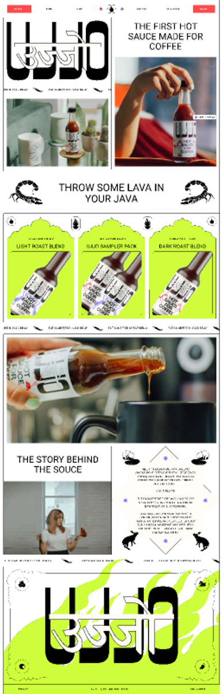

# UJJO — The First Hot Sauce Made For Coffee (38-Amaliy Ish)

Figma dizaynining yuqori aniqlikdagi (**Pixel-Perfect**) to'liq, zamonaviy, interaktiv va to'liq moslashuvchan (fully responsive) eksklyuziv kofe souslari brendi veb-platformasi: **UJJO (node-id: 1:130)**.

[-F24E1E?logo=figma&logoColor=white)](https://www.figma.com/file/bfuerSMKMDh802FWCSWioB/Ujjo?type=design&node-id=1%3A130&mode=design&t=KZKQDK7iKdmOMFvI-1)

---

## 📸 Figma Dizayn Ko'rinishi (Master Canvas)

---

## 📌 Loyiha Haqida

Ushbu loyiha Figma platformasidagi mashhur **UJJO (The First Hot Sauce Made For Coffee)** dizaynining to'liq ekotizimi va dizayn tokenlari (node-id: `1:130`) asosida 100% aniqlik bilan ishlab chiqildi. Sayt dunyodagi birinchi qahva uchun ixtisoslashgan tabiiy vanil, qalampir va shirin karamel ekstraktlaridan iborat noyob souslar brendining rasmiy tijorat platformasidir.

- **Figma Manzili**: [Ujjo — node-id: 1:130](https://www.figma.com/file/bfuerSMKMDh802FWCSWioB/Ujjo?type=design&node-id=1%3A130&mode=design&t=KZKQDK7iKdmOMFvI-1)
- **Topshiriq**: 38-Amaliy Ish
- **GitHub Repozitoriyasi**: [https://github.com/soxibs48-eng/amaliy38](https://github.com/soxibs48-eng/amaliy38)
- **Til**: To'liq o'zbek tilida (100% gastronomik va kreativ brending atamalari bilan)

---

## ✨ Asosiy Imkoniyatlar va Bo'limlar

1. **Header & Aylanuvchi Medal**:
   - `Qaynoq Taklif` qizil pilli belgisi.
   - Aylanuvchi medalion olov belgisi.
   - Dinamik savat hisoblagichi `SAVAT (0)`.
   - "Xarid qilish" tezkor harakat tugmasi.

2. **Hero Bo'limi**:
   - Gigant `UJJO` devanagari-lotin mashup tipografik logotipi.
   - "QAHVA UCHUN YARATILGAN BIRINCHI ACHCHIQ SOUS!" shiori.
   - Shisha idish va qo'lda ushlab turilgan real mahsulot fotolari.

3. **Harakatlanuvchi Marquee Lenta (Ticker)**:
   - "QAHVANGIZGA OLOV QO'SHING! // THROW SOME LAVA IN YOUR JAVA" yuguruvchi satri.

4. **"Qahvangizga Haqiqiy Lava Qo'shing" Banneri**:
   - Vintage skorpion illyustratsiyalari va monumental shior.

5. **Limon-Yashil Mahsulotlar Vitrinasi (Arched Cards)**:
   - **Light Roast Blend** ($15.00) — Yengil qahvalar uchun vanil va mevali habanero.
   - **UJJO Sampler Pack** ($28.00) — Eng mashhur ikki xil sous to'plami.
   - **Dark Roast Blend** ($15.00) — Espresso uchun dolchin, kakao va olovli qalampir.
   - Real interaktiv "Savatga qo'shish" tugmalari va bildirishnomalar.

6. **Harakatdagi Quyilish Shoti (Pouring Action Shot)**:
   - Sousni qora qaynoq qahvaga quyishning kinematik fotosurati.

7. **Sous Tarixi (The Story Behind the Sauce)**:
   - Ta'sischi Lauren D'Souza portreti va ramkali unikal hikoya.

8. **Gigant Futer & Yangiliklarga Obuna**:
   - Katta UJJO sarlavhasi, obuna formasi va havolalar.

---

## 🛠 Texnologiyalar Steki

- **HTML5**: Semantik, kross-brauzer to'liq moslashuvchan maket.
- **CSS3**: Brutalist neo-retro dizayn tokenlari, lime chartreuse rang palitrasi (`#b6f500`), marquee animatsiyalari.
- **Vanilla JavaScript (ES6+)**:
  - `initCart()` — Mahsulotlarni savatga qo'shish va hisoblash.
  - `initNewsletter()` — Obuna formasi integratsiyasi.
- **Vercel**: `vercel.json` orqali toza URL manzillari bilan global joylashtirishga tayyor.
